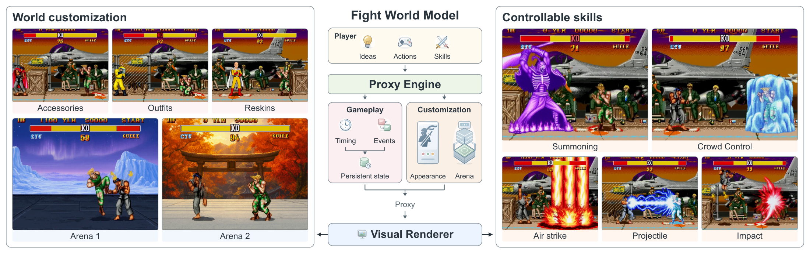
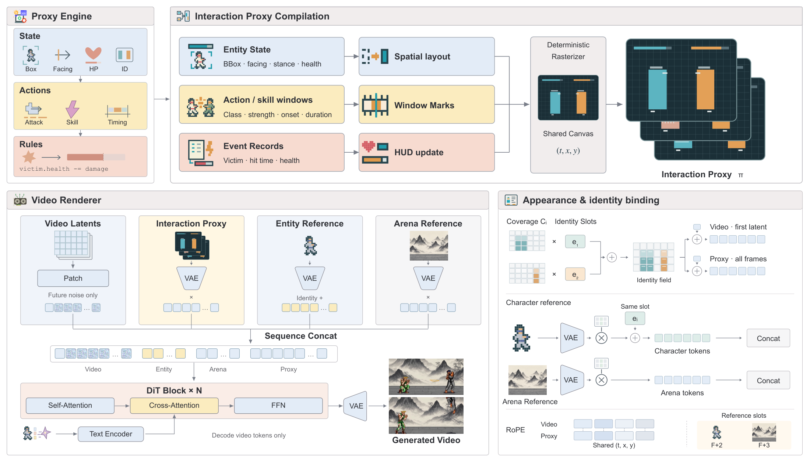

<h1 align="center">Fight World Model</h1>

<p align="center"><b>Customizable Combat through Visual Interaction Proxies</b></p>

<p align="center">
  <a href="https://fight-world-model.github.io/">
    
  </a>
  <a href="https://arxiv.org/abs/2610.40607">
    
  </a>
  <a href="https://arxiv.org/pdf/2610.40607">
    
  </a>
  <a href="LICENSE">
    
  </a>
</p>

<p align="center">
  
</p>

<p align="center">
  <i>Execute the rules. Render the fight.</i>
</p>

> Fight World Model (FWM) connects executable combat rules to video generation through a visual interaction proxy. An engine resolves interactions and maintains state; a deterministic compiler aligns actions and their consequences with fighter identities and video frames; a video model renders the resulting fight with character and arena references.

A protected fighter can react to a hit without losing health, while lifesteal damages the recipient and heals the attacker. FWM renders these outcomes under edited rules without retraining the renderer. Changing a character or arena reference preserves the prescribed interaction, and identity binding keeps appearances associated with the intended fighters across side switches.

## 📰 News

- **[2026-10]** The [project page](https://fight-world-model.github.io/) and [paper](https://arxiv.org/abs/2610.40607) are available.

## 🚀 Release Roadmap

- [x] Project page
- [x] Technical report
- [ ] Inference code
- [ ] Pretrained weights

## 🛠️ Method

<p align="center">
  
</p>

The interaction proxy separately encodes attempted actions, brief hit reactions, and persistent health on a shared canvas and timeline. This separation lets the engine specify damage scaling, limited-hit immunity, lifesteal, and multi-stage skill mechanisms through the same conditioning format.

---


## 📄 Citation

```bibtex
@article{li2026fight,
  title={Fight World Model: Customizable Combat through Visual Interaction Proxies},
  author={Li, Jiahua and John, Zixu and Zhong, Tom and Wu, Fuping and Xu, Tianhao and Zhang, Ruicheng and Zhou, Jun and Xu, Zunnan},
  journal={arXiv preprint arXiv:2610.40607},
  year={2026}
}

